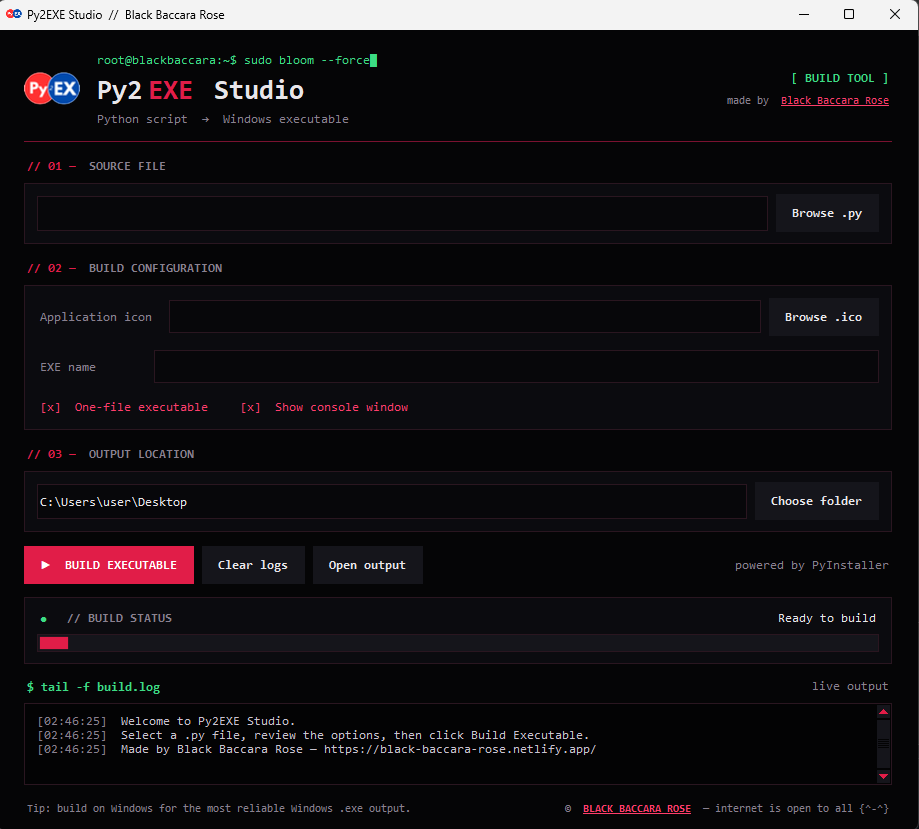

<div align="center">


# Py2EXE Studio

**Python script → Windows executable. One click.**

```text
root@blackbaccara:~$ sudo bloom --force█
```

[](https://www.python.org/)
[](#-04--requirements)
[](https://pyinstaller.org/)
[](https://docs.python.org/3/library/tkinter.html)
[](https://black-baccara-rose.netlify.app/)

<br>



</div>

---

## // 01 — what is this

**Py2EXE Studio** is a small desktop GUI that wraps [PyInstaller](https://pyinstaller.org/) so you can turn any `.py` script into a standalone Windows `.exe` without touching the command line.

Pick your script, choose a few options, hit **BUILD EXECUTABLE**, and watch the live log. That's it.

## // 02 — features

- **One-click builds** — select a `.py` file and build it into an `.exe`
- **One-file or one-folder** output (`--onefile` / `--onedir`)
- **Console toggle** — hide the console window for GUI apps (`--windowed`)
- **Custom app icon** — pick any `.ico` file for your executable
- **Custom EXE name** — auto-filled from your script name
- **Live build log** — colour-coded output streamed in real time (command, success, errors)
- **Non-blocking UI** — builds run in a background thread, the window never freezes
- **Input validation** — checks the source file, icon, output folder and EXE name before building
- **Dark rose terminal theme** — made to feel like home for people who live in a shell

## // 03 — quick start

```bash
git clone https://github.com/black-baccara-rose/Py2EXE-Studio.git
cd Py2EXE-Studio
py -m pip install -r requirements.txt
py main.py
```

> On Linux / macOS use `python3` instead of `py`.

## // 04 — requirements

| Requirement | Notes |
|---|---|
| Python **3.8+** | Tkinter is bundled with the official Windows installer |
| **PyInstaller** | Installed via `requirements.txt` |
| **Windows** | Recommended for building a Windows `.exe` (PyInstaller does not cross-compile) |

## // 05 — how to use

1. **Source file** — click **Browse .py** and choose the script you want to convert.
2. **Build configuration**
   - **Application icon** *(optional)* — choose a `.ico` file.
   - **EXE name** — leave empty to reuse the script's name.
   - **One-file executable** — pack everything into a single `.exe` (on by default).
   - **Show console window** — untick this for GUI apps so no terminal pops up.
3. **Output location** — choose the folder where the result should be saved (defaults to your Desktop).
4. Click **▶ BUILD EXECUTABLE** and follow the log.
5. When it finishes, hit **Open output** to jump straight to your new `.exe`.

### Where does my `.exe` end up?

| Mode | Result |
|---|---|
| One-file | `<output>/<name>.exe` |
| One-folder | `<output>/<name>/<name>.exe` |

PyInstaller's temporary work and `.spec` files go to `<output>/_py2exe_build/` — you can safely delete that folder after a successful build.

## // 06 — under the hood

Py2EXE Studio just assembles and runs a PyInstaller command for you. A typical build looks like this:

```bat
python -m PyInstaller --noconfirm --clean ^
  --name my_script ^
  --distpath "C:\Users\you\Desktop" ^
  --workpath "C:\Users\you\Desktop\_py2exe_build\work" ^
  --specpath "C:\Users\you\Desktop\_py2exe_build\spec" ^
  --onefile --windowed --icon app.ico ^
  "C:\path\to\my_script.py"
```

The exact command is always printed at the top of the build log, so you can copy it and run it by hand if you ever need to.

## // 07 — build Py2EXE Studio itself

Yes, you can use the tool to compile itself. Open it, then set:

- **Source file** → `main.py`
- **Application icon** → `assets/P.ico`
- **EXE name** → `Py2EXE-Studio`
- untick **Show console window**

## // 08 — troubleshooting

| Problem | Fix |
|---|---|
| *"PyInstaller not installed"* | Run `py -m pip install -r requirements.txt` with the **same Python** you use to launch the app. |
| Antivirus flags the `.exe` | Common false positive for PyInstaller one-file builds. Try **one-folder** mode or sign the executable. |
| Icon is rejected | Only real `.ico` files are accepted — renaming a `.png` won't work. |
| `.exe` not created on Linux / macOS | PyInstaller builds for the OS it runs on. Build on Windows to get a Windows `.exe`. |
| **Open output** does nothing | This button uses `os.startfile`, which is Windows-only. |

## // 09 — project structure

```text
Py2EXE-Studio/
├── main.py              # the whole app (Tkinter GUI + build logic)
├── requirements.txt     # pyinstaller
├── README.md
└── assets/
    ├── logo.png         # README logo
    ├── screenshot.png   # README screenshot
    └── P.ico            # app icon
```

## // 10 — author

```text
$ whoami
black_baccara_collective

$ cat mission.txt
liberate information.
protect the fragile.
bloom in the dark.
```

**Black Baccara Rose**
🌐 [black-baccara-rose.netlify.app](https://black-baccara-rose.netlify.app/) · 🐙 [@black-baccara-rose](https://github.com/black-baccara-rose)

If this tool saved you time, drop a ⭐ on the repo.

---

<div align="center">

`© BLACK BACCARA ROSE — internet is open to all {^-^}`

</div>
